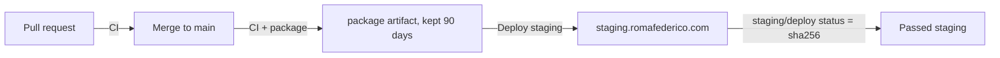

# romafederico.com

Personal consulting site for Federico Roma. Pure HTML + CSS, no build step.

## Deployment

Merging to `main` changes **staging only**; the live site changes only when
Federico publishes a `v*` release (being built, epic #1 — until v1.0.0 the live
site does not change).



- **CI** (`.github/workflows/ci.yml`) runs on every pull request and push to
  `main`: `html` (W3C Nu checker, HTML and CSS), `links` (internal links and
  image paths), `page-load` (headless Chromium, no errors), `no-js` (the site
  stays HTML + CSS only), `scripts` (shellcheck, actionlint, deploy tests) and
  `package`.
- **Package** (`deploy/build-package.sh`): one `.tar.gz` per commit with a
  sha256, holding exactly the files listed in `deploy/site-files`. Adding a page
  or image means adding it there. On `main` CI uploads it as the artifact
  `package-<sha>`.
- **Staging** (`.github/workflows/deploy-staging.yml`): after CI passes on
  `main`, `deploy/deploy.sh --env staging` installs that commit's package
  (never rebuilt) on the dev server through `deploy-gate-rf`, then
  `deploy/smoke-test.sh` checks the site. The result is the commit status
  `staging/deploy`; `https://staging.romafederico.com/version.json` shows the
  installed commit. Staging is behind basic auth and `noindex`.
- Settings are committed in `deploy/environments/`; secrets live in AWS
  Parameter Store under `/romafederico/staging/*`, read through a GitHub OIDC
  role. The staging deploy uses no GitHub secrets.
- The old `.github/workflows/deploy.yml` (rsync to DreamHost on every push) is
  disabled and will be removed by #11.

## Local preview

```
python3 -m http.server 8000
```

Then visit <http://localhost:8000>.
