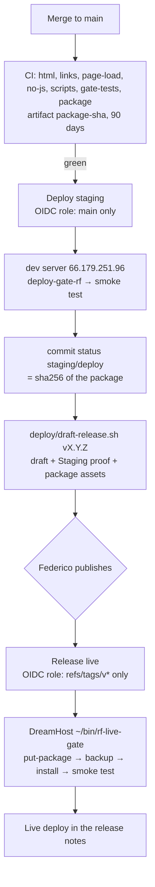

# Deployment, configuration and secrets

How the site gets from a merge to staging and from a published release to the live site, what each piece checks, and where the settings and secrets are (epic #1). Step-by-step commands are in the [Deploy runbook](runbook-deploy.md). Previewing the site on your own computer is in the [README](../README.md).

## What a deploy ships

**The site files, nothing else.** The site is hand-written HTML + CSS: `index.html`, `style.css`, `avatar.jpg`. There is no build step, no database and no server code.

**The site stays JavaScript-free.** Federico wants it that way (#4). **CI / no-js** fails a PR on any `<script`, `on…=` event attribute or `javascript:` URL in a site file, or any `*.js` / `*.mjs` / `*.cjs` file in the repo outside `.github/`. It runs again on the unpacked package. The smoke tests check every home page they load has no `<script`, and `rf-live-gate` refuses to install an `index.html` that has one.



## The package

[`deploy/build-package.sh`](../deploy/build-package.sh) (#5) builds one file per commit, `romafederico-site-<full sha>.tar.gz` and its `.sha256`:

| Inside | From |
|---|---|
| `site/<file>` | each path in [`deploy/site-files`](../deploy/site-files): `index.html`, `style.css`, `avatar.jpg` |
| `BUILD.json` = `{"commit":"<sha>"}` | outside `site/`, so it is never served |

**Adding a page or image means adding it to `deploy/site-files`.** CI's `links`, `no-js` and `page-load` run again on the unpacked package, so a file the page uses but the list misses fails there. The list never holds `version.json`. Everything else in the repo (`README.md`, `docs/`, `deploy/`, `tests/`) stays out of the package and never reaches a server.

It takes only committed files (`git archive`) and is reproducible: sorted names, the commit's time, owner 0/0, `gzip -n`. CI's `package` job builds it on every PR and push. On `main` it is kept as the artifact `package-<sha>` for **90 days**. Staging installs that artifact and never rebuilds. `deploy/draft-release.sh` attaches it to the draft release as two assets, so release and rollback don't depend on the artifact after that.

## `/version.json`

A static file the gate writes into the installed folder at install time, so the package's sha256 is the same on staging and live. One line:

```json
{"site":"romafederico.com","environment":"live","version":"v1.0.0","commit":"<40 hex>","package_sha256":"<64 hex>","installed_at":"2026-11-10T12:00:00Z"}
```

| Field | From |
|---|---|
| `environment` | fixed in each gate: `staging` or `live` |
| `version` | `sha-<first 7>` on staging, `vX.Y.Z` on live |
| `commit` | the package's `BUILD.json` |
| `package_sha256`, `installed_at` | the gate's `install` |

No JavaScript reads it and nothing on the page links to it. Local preview has none. On staging it is behind the password, like every other path, and nginx sends `Cache-Control: no-store` for it. On live it answers without a password; DreamHost may cache it for a few minutes, so the smoke test polls with `?t=<time>`.

## CI

[`.github/workflows/ci.yml`](../.github/workflows/ci.yml) runs on every PR and every push to `main`, with no secrets.

| Check | What it does |
|---|---|
| **CI / html** | W3C Nu checker on the site's HTML and CSS. |
| **CI / links** | Every internal `href`/`src` and CSS `url()` points to a file in `deploy/site-files`; `#fragments` point to an id. External links are not checked. |
| **CI / page-load** | Headless Chromium loads `/`: no console or page error, no failed request or non-2xx/3xx response, a `<title>`, `avatar.jpg` loads. Screenshots at 390 and 1440 wide are kept as an artifact. |
| **CI / no-js** | No JavaScript (see above). |
| **CI / scripts** | shellcheck on `deploy/` and `tests/`, actionlint, and the tests in `deploy/test/` for `deploy.sh`, `smoke-test.sh` and `draft-release.sh` (fake `gh`, `aws`, `ssh`, `docker`, `curl`: nothing leaves the runner). |
| **CI / gate-tests** | `deploy/test/rf-live-gate-test.sh`: the live gate in a fake home folder with the other two live sites beside it. |
| **CI / package** | Builds the package, checks `BUILD.json`, runs links, no-js and page-load on the unpacked `site/`. On `main` it uploads `package-<sha>`. |

Keep the check names stable. The merge check relies on them.

## Target settings: `deploy/environments/`

Committed on purpose: they aren't secret, and **there are no GitHub secrets or variables** for the pipeline. `deploy/deploy.sh` reads them as data, and only the keys it knows.

| File | Holds |
|---|---|
| `staging.conf` | `DEPLOY_HOST=66.179.251.96`, `DEPLOY_USER=deploy`, `DEPLOY_DIR=/opt/rf-staging`, `SITE_URL=https://staging.romafederico.com`, the role `romafederico-gha-staging`, `SSM_PATH=/romafederico/staging/` |
| `live.conf` | `DEPLOY_HOST=pdx1-shared-a1-22.dreamhost.com`, `DEPLOY_USER=romafederico`, `SITE_URL=https://romafederico.com`, the role `romafederico-gha-live`, `SSM_PATH=/romafederico/live/` |
| `*.known_hosts` | The server's host key. SSH runs with `StrictHostKeyChecking=yes` against this file only. |

[`deploy/live-actors`](../deploy/live-actors) lists the GitHub logins that may start a live deploy or rollback: `romafederico` and the CoS account `rfminibbot`. The list in force is the one in the tag being deployed. Changing it needs a PR.

## Secrets: Parameter Store and OIDC

Every secret is in AWS SSM Parameter Store in Federico's AWS account `cos` (441641151006, `us-east-1`). Workflows reach it through GitHub OIDC, with no stored AWS keys (#3). Both roles have the permissions boundary `romafederico-boundary`:

| Role | Trusted for | May read |
|---|---|---|
| `romafederico-gha-staging` | runs on `refs/heads/main` | `/romafederico/staging/*` only |
| `romafederico-gha-live` | runs on `refs/tags/v*` | `/romafederico/live/*` only |

| Parameter | Type | Used by | Reaches the server |
|---|---|---|---|
| `/romafederico/staging/BASIC_AUTH_USER` | String | the password on every staging page; must match `^[a-z0-9_-]{1,32}$` | in the htpasswd line |
| `/romafederico/staging/BASIC_AUTH_PASSWORD` | SecureString | same; the deploy hashes it with `htpasswd -B` (bcrypt) from a pinned `httpd` image | **no**, only the bcrypt hash |
| `/romafederico/staging/DEPLOY_SSH_KEY` | SecureString | `deploy@66.179.251.96`, forced to `deploy-gate-rf` | **no** |
| `/romafederico/live/DEPLOY_SSH_KEY` | SecureString | `romafederico@` DreamHost, forced to `~/bin/rf-live-gate` | **no** |

Every value is masked in the log before anything else runs. An SSH key is on disk only as a mode-600 temp file, removed on exit. The live deploy reads only `/romafederico/live/DEPLOY_SSH_KEY`. Changing a value: [runbook §5](runbook-deploy.md#5-change-a-password-or-secret).

The repo secret `DREAMHOST_SSH_KEY` is left over from the old rsync deploy. Nothing uses it; it and its key line on DreamHost are removed in #14.

## The two gates

Each SSH key is forced to one script (`restrict,command=…` in `authorized_keys`), so a leaked key can do only what that script allows.

**`deploy-gate-rf`** on the dev server (#2, `/usr/local/bin/deploy-gate-rf`, root-owned, user `deploy`). It is maintained by the CoS and isn't in this repo; its allow-list is posted on #2. Every path is fixed under `/opt/rf-staging`. It logs to syslog (`journalctl -t deploy-gate-rf`).

| Command | Does |
|---|---|
| `put-package <sha256>` | stdin (max 50 MiB) → `packages/<sha256>.tar.gz`, refused if the checksum differs |
| `install <sha256> <version>` | re-checks the package (only `BUILD.json` and `site/…`, no links, no `..`, no `site/version.json`), unpacks it to `sites/<sha256>/`, writes `version.json`, points `current` at it |
| `put-htpasswd` | one `user:bcrypt` line on stdin → `/opt/rf-staging/htpasswd` |
| `current` | `current/version.json`, or `none` |
| `prune` | keeps the 5 newest packages and `sites/` folders, never the current one |

**`rf-live-gate`** on DreamHost (#8, [`deploy/dreamhost/rf-live-gate.sh`](../deploy/dreamhost/rf-live-gate.sh), installed as `~/bin/rf-live-gate` by the CoS, #9). The same DreamHost user also hosts diegokravetz.com and marielgaribaldi.com, so it touches only `~/romafederico.com`, `~/rf-backups` and its own temp folder `~/.rf-new-<stamp>`. One command at a time (`~/rf-backups/gate.lock`); every request is logged in `~/rf-backups/gate.log` (`OK`, `FAILED` or `REFUSED`).

| Command | Does |
|---|---|
| `put-package <sha256>` | stdin (max 10 MiB) → `~/rf-backups/packages/<sha256>.tar.gz`, only if the checksum matches and the tar holds only `BUILD.json` and `site/…` |
| `backup <label>` | the whole `~/romafederico.com` folder → `~/rf-backups/live-<UTC yyyymmdd-hhmmss>-<label>.tgz`; prints `BACKUP=<name>` |
| `install <sha256> <vX.Y.Z>` | unpacks `site/` into a new folder, refuses an `index.html` with `<script`, copies in the names in `KEEP`, writes `version.json`, then swaps folders by rename. The old folder goes to `~/rf-backups/site-<stamp>/` (`PREVIOUS=`). On any failure the old one is put back. |
| `current` | `~/romafederico.com/version.json`, or `none` |
| `prune` | keeps 5 packages, 10 backups and 10 `site-*` folders; trims `gate.log`. No workflow calls it on live yet. |

`KEEP` lists the names in the live folder that aren't in the package but must stay: DreamHost's own `.dh-diag`, `favicon.ico` and `favicon.gif` (#22). Changing it needs a PR. Anything else is refused (exit 2). The gate has **no restore command**: restoring a backup is a manual CoS step ([runbook §4](runbook-deploy.md#4-restore-the-live-site-from-a-backup)). The file on DreamHost is a copy, so a change to `rf-live-gate.sh` is reinstalled by the CoS after merge.

## Staging on the dev server

Host nginx on the dev server (66.179.251.96) serves `https://staging.romafederico.com` straight from `/opt/rf-staging/current`, with a Let's Encrypt certificate. **No containers, no new service, no new port**: the server is small and shared with nu-mvc and diegokravetz.com staging. The server block is `/etc/nginx/sites-available/rf-staging` (#2, posted there in full):

- port 80 serves only `/.well-known/acme-challenge/` and redirects everything else to https;
- port 443: `root /opt/rf-staging/current`, `autoindex off`, `server_tokens off`;
- `auth_basic` with `/opt/rf-staging/htpasswd` at server level, so **every** request needs the password;
- `X-Robots-Tag: noindex, nofollow` on every response, repeated in each location;
- `/robots.txt` answers `Disallow: /` from nginx itself, so the package stays the same as live;
- `/version.json` gets `Cache-Control: no-store`; dot-files answer 404.

## Merge to main → staging

[`.github/workflows/deploy-staging.yml`](../.github/workflows/deploy-staging.yml) (#7) runs when **CI** succeeds on a push to `main`. It deploys the commit CI checked, one run at a time (concurrency group `deploy-staging`, never cancelled halfway). It runs [`deploy/deploy.sh`](../deploy/deploy.sh) `--env staging --sha <sha>`:

1. Downloads `package-<sha>` and checks its sha256. If the artifact is gone (after 90 days), it stops: deploy a newer commit.
2. Reads `staging.conf` and every parameter under `/romafederico/staging/`. If `BASIC_AUTH_USER`, `BASIC_AUTH_PASSWORD` or `DEPLOY_SSH_KEY` is missing, it stops and names them, before touching the server.
3. Makes the bcrypt htpasswd line; the password goes in on stdin and never leaves the runner.
4. Through `deploy-gate-rf`: `put-htpasswd` → `put-package` → `install <sha256> sha-<7>` → `current` (must report the install) → `prune`.
5. [`deploy/smoke-test.sh`](../deploy/smoke-test.sh) `--env staging`: `/version.json` reports the commit, version and package within 60 s; `/` is 200 with "Federico Roma", no `<script` and `X-Robots-Tag: noindex`; `/style.css` and `/avatar.jpg` are 200; `/robots.txt` has `Disallow: /`; `/README.md` is 404; without the password `/` and `/version.json` are 401. A failed smoke test fails the deploy; nothing is undone.

Then it sets the commit status **`staging/deploy`**. On success the description is `sha256 <package checksum>`. That is the "passed staging" proof the release checks.

**Manual run:** Actions → Deploy staging → Run workflow on `main`, with an optional full `sha` of an older commit on `main` whose artifact still exists. It never builds, refuses other branches and commits not on `main`, and sets `staging/deploy` only when it succeeds, so a failed rehearsal doesn't remove an older proof.

## Draft release

[`deploy/draft-release.sh`](../deploy/draft-release.sh) `vX.Y.Z[-rc.N] [<sha>]` (#10) makes or updates a **draft** release. Agents run it; only Federico publishes. It refuses before writing anything unless:

- the version is higher than the last published release (pre-releases included), with no tag or published release of that name;
- the commit is on `main`;
- `staging/deploy` is `success` with a `sha256`, and the newest Deploy staging run is that run (staging still runs the commit). With `BASIC_AUTH_USER`/`BASIC_AUTH_PASSWORD` set, it also asks staging's `/version.json`;
- CI's artifact for the commit has the same sha256.

The notes start with a **Heads-up**: one line per PR since the last published full release (before the first one, since `54d0a70`, where epic #1 started) that changes `.github/`, `deploy/` or `deploy/site-files`, then **Page changes** for the PRs that change a site file; or `Heads-up: nothing risky in this release.` The first release also names the files the live site loses (the old deploy copied the whole repo: `.gitignore`, `README.md`). Then GitHub's generated notes, then a **Staging proof** (commit, package, `sha256`, staging run, `/version.json`, time). The package and its `.sha256` are attached. `vX.Y.Z-rc.N` is made as a pre-release. The last line printed is the draft's URL.

## Published release → live

[`.github/workflows/release.yml`](../.github/workflows/release.yml) (**Release live**, #11) runs when a `v*.*.*` tag is pushed, which is what publishing the draft does. Publishing is Federico's approval. One live run at a time (group `deploy-live`, shared with rollback, never cancelled). It runs `deploy/deploy.sh --env live --release vX.Y.Z`:

1. **Guards**, before AWS or the server: the triggering actor is in `deploy/live-actors`; the run is on `refs/tags/vX.Y.Z`; the tag's commit is on `main`; the release is published and has both package assets; the package matches its `.sha256`, and that sha256 equals the **Staging proof** and the commit's `staging/deploy`.
2. Reads only `/romafederico/live/DEPLOY_SSH_KEY`.
3. Through `rf-live-gate`: `put-package` → `backup vX-Y-Z` → `install <sha256> vX.Y.Z` → `current` (must report the release, commit and package).
4. Smoke test `--env live`, with no password: `/version.json` reports the commit, `vX.Y.Z` and the package within 120 s; `/` and `https://www.romafederico.com/` are 200 with "Federico Roma" and no `<script`; `/style.css` and `/avatar.jpg` are 200; `/README.md` is 404.
5. A second job (the only one with `contents: write`) appends **Live deploy** to the release notes: package and sha256, backup name, run link, time. It also does this on failure, as `## Live deploy: FAILED at <step>`.

**Dry run:** a pre-release (`vX.Y.Z-rc.N`, or marked pre-release on GitHub when the run starts), or Actions → Release live → Run workflow on a `v*` tag. It does the guards, `put-package`, `backup` and `current`, then stops. No install, no smoke test, no notes.

## Rollback

[`.github/workflows/rollback-live.yml`](../.github/workflows/rollback-live.yml) (**Rollback live**, #12), Run workflow with "Use workflow from" = an earlier tag `vA.B.C`. **Dry run is on by default.** Its first step checks the starter against that tag's `deploy/live-actors`, then it runs `deploy/deploy.sh --env live --rollback vA.B.C`: the same guards as a release, and if the notes record a **Live deploy**, its sha256 must be this package's. A release candidate or a release marked pre-release never went live, so it is refused. Then `put-package`, `backup rollback-vA-B-C`, `install`, `current`, and the smoke test expecting `vA.B.C`. Every run (refused, failed, dry or real) adds a line under **Live rollbacks** in `vA.B.C`'s notes. A dispatch runs the workflow as it is in that tag; it was merged before `v1.0.0`, so every release has it.

## Backups on the live site

Every live deploy and rollback, dry runs too, takes a backup before installing: `~/rf-backups/live-<UTC stamp>-<label>.tgz`, the whole `~/romafederico.com` folder. Each install also moves the folder it replaces to `~/rf-backups/site-<stamp>/`. The site is small, so they cost little, but nothing removes them yet: the live workflows don't call the gate's `prune`. Restoring one is [runbook §4](runbook-deploy.md#4-restore-the-live-site-from-a-backup).

## The old deploy (removed)

Until epic #1, `.github/workflows/deploy.yml` rsynced the whole repo to `~/romafederico.com` on every push to `main`, with the repo secret `DREAMHOST_SSH_KEY`. The CoS disabled it on 2026-11-03 and #11 removed the file. A published release and a rollback are now the only ways to change the live site. Until `v1.0.0` (#14) the live site stays as the old deploy left it.
