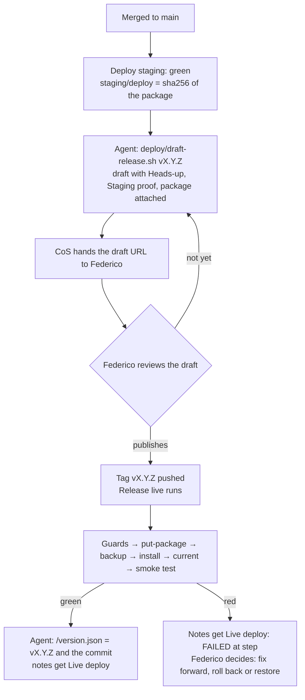

# Deploy runbook

How to deploy to staging, release to the live site, roll back, restore a backup and change a secret. Each step is **command → expect → stop if**. The background (what the scripts check and why) is in [Deployment, configuration and secrets](deployment-and-configuration.md).

When a step says **stop**, don't work around it: no hand edits on a server, no skipped checks, no second try with other flags. Write down what you saw (run link, error line) and pass it to the CoS.

## Who does what

| Who | Does |
|---|---|
| **Agents** | Read deploy runs and statuses, re-run a failed staging deploy once, start a manual staging deploy, prepare draft releases, watch the release and rollback runs and check `/version.json`. |
| **CoS** | The dev server (`deploy-gate-rf`, nginx, `/opt/rf-staging`), AWS and Parameter Store (`/romafederico/<env>/*`); reinstalls `rf-live-gate` on DreamHost after it changes; starts live workflows and restores backups only on Federico's order, recorded as a comment. |
| **Federico** | Reviews and publishes releases; orders rollbacks and restores. |

**Agents never:**

- publish a release, or push or create a `v*` tag;
- start or re-run **Release live** or **Rollback live**;
- touch DreamHost or the dev server (no SSH, no panel, no SFTP), or edit files on any server by hand;
- read `/romafederico/live/*`.

The CoS account `rfminibbot` is in `deploy/live-actors`, and workers share it, so the CoS safety hook blocks most of these. If it blocks you, report it; don't look for another way.

## Commands used below

```bash
REPO=romafederico/romafederico.com
STAGING=https://staging.romafederico.com
LIVE=https://romafederico.com
# Staging needs basic auth on every request, /version.json too: /romafederico/staging/BASIC_AUTH_USER
# and BASIC_AUTH_PASSWORD (the CoS has them). Without them, staging answers 401.
```

## 1. Deploy to staging

Merging a PR to `main` deploys it. CI runs first, then **Deploy staging** (`.github/workflows/deploy-staging.yml`, #7) installs CI's package for that commit through `deploy-gate-rf` and runs the smoke test. Nothing is rebuilt.

1. **Find the run** for the commit through its `staging/deploy` status. `gh run list` shows main's newest commit as `headSha` for a Deploy staging run, not necessarily the commit it deployed, so go by the status.
   ```bash
   SHA=$(gh api repos/$REPO/commits/main -q .sha)
   gh run list -R $REPO --workflow ci.yml --limit 3 --json databaseId,headSha,event,conclusion
   gh api repos/$REPO/commits/$SHA/status -q '.statuses[] | select(.context=="staging/deploy") | [.state, .target_url, .description] | @tsv'
   ```
   **Expect** a CI `push` run for `$SHA` with `success`. Then `pending  …/actions/runs/<run id>  Deploying to staging` a minute later, and `success  …/actions/runs/<run id>  sha256 <64 hex>` when it's done.
   **Stop if** CI failed: a red commit is never deployed. If CI is green and there's no status after 5 minutes, look at `gh run list -R $REPO --workflow deploy-staging.yml --limit 3`: a run may be waiting for an earlier one (they don't overlap). If a Deploy staging run for a newer commit is queued, running or done, nothing to do: that commit contains this one.
2. **Wait for it.**
   ```bash
   gh run watch -R $REPO <run id> --exit-status
   gh run view -R $REPO <run id> --log | grep -E '==>|ok   |FAIL'
   ```
   **Expect** exit 0, `==>` lines `Downloading artifact package-<sha>`, `ok: romafederico-site-<sha>.tar.gz sha256 …`, `Reading parameters under /romafederico/staging/`, `put-htpasswd`, `put-package`, `install <sha256> sha-<7>`, `current`, `prune`, `Smoke test https://staging.romafederico.com`, then `ok` lines for `/version.json → staging <sha> sha-<7> package …`, `/ → 200, has 'Federico Roma'`, `/ has no <script`, `/ X-Robots-Tag: noindex, nofollow`, `/style.css`, `/avatar.jpg`, `/robots.txt → 200, Disallow: /`, `/README.md → 404`, and `/` and `/version.json` `without credentials → 401`. Last line: `==> Done: https://staging.romafederico.com runs sha-<7> (sha256 …)`.
   **Stop if** it fails: read the `::error::` line and the run summary, and go to step 4.
3. **Check the proof.**
   ```bash
   gh api repos/$REPO/commits/$SHA/status -q '.statuses[] | select(.context=="staging/deploy") | .state'
   curl -su "$BASIC_AUTH_USER:$BASIC_AUTH_PASSWORD" "$STAGING/version.json?t=$(date +%s)"
   ```
   **Expect** `success`, and one line of JSON with `"site":"romafederico.com"`, `"environment":"staging"`, `"version":"sha-<7>"`, `"commit"` = `$SHA` and the same `package_sha256` as the status. A release needs both. Without the password, `curl` gets the 401 page; the smoke test already checked `/version.json`.
4. **Re-run a failed deploy once.** It downloads the same artifact and doesn't rebuild.
   ```bash
   gh run rerun -R $REPO <run id> --failed
   ```
   **Stop if** it fails the same way again. File a ticket with the failing line.
   - `no artifact package-<sha> from CI on main`: the artifact expired (90 days). Deploy a newer commit.
   - `missing required parameters in Parameter Store: …` or `BASIC_AUTH_USER must match …`: nothing reached the server. CoS (section 5).
   - `put-htpasswd failed`, `put-package failed`, `install failed` right after the command: the gate refused or SSH failed. The CoS reads `journalctl -t deploy-gate-rf` on the dev server.
   - The smoke test fails: staging keeps the new install (nothing is undone). Fix forward, or put the previous commit back with a manual run (below).

**Manual run.** Redeploys staging without a new merge, for example after a secret change or to put an older commit on staging. It never builds and runs only on `main`.

```bash
gh workflow run deploy-staging.yml -R $REPO --ref main                    # main's current commit
gh workflow run deploy-staging.yml -R $REPO --ref main -f sha=<40 hex>    # an older commit on main (artifact < 90 days)
gh run list -R $REPO --workflow deploy-staging.yml --limit 1 --json databaseId,event,status
```

**Expect** a `workflow_dispatch` run whose summary starts with **Manual run** (who started it, which package), and the same log as step 2. A manual run sets `staging/deploy` only when it succeeds, so a failed one doesn't take away an older proof. If you deployed an older commit, run it again without `sha` afterwards: a draft release checks that the newest Deploy staging run is the release commit's.
**Stop if** it says `sha must be 40 hex` or `commit … is not on main`.

## 2. Release to the live site



**Pick the version.** Patch (`v1.0.1`) for fixes only: a typo, a broken link, a CSS fix. Minor (`v1.1.0`) when it adds something visible: a section, a page, a new image. Major (`v2.0.0`) when it breaks something people rely on, such as removed pages or changed URLs. It must be higher than the last published release, pre-releases included. A pre-release `vX.Y.Z-rc.N` is a dry run of the live deploy (the `v1.0.0-rc.1` rehearsal, #14): published, it does everything up to the backup and installs nothing.

1. **Agent: prepare the draft.** Staging must run the commit (section 1).
   ```bash
   gh release list -R $REPO --limit 5                                # last published version, and drafts
   read -r BASIC_AUTH_USER; read -rs BASIC_AUTH_PASSWORD             # staging basic auth, optional, kept out of history
   export BASIC_AUTH_USER BASIC_AUTH_PASSWORD
   deploy/draft-release.sh vX.Y.Z                                    # main's HEAD
   deploy/draft-release.sh vX.Y.Z <sha>                              # a given commit on main
   unset BASIC_AUTH_USER BASIC_AUTH_PASSWORD
   ```
   **Expect** `==>` lines `version vX.Y.Z (last published: …, last full: …)`, `commit <sha> is on main`, `staging proof: run <id>, package sha256 …`, `package romafederico-site-<sha>.tar.gz sha256 …`, `heads-up: …`, `created draft release vX.Y.Z` (or `updated …`), `attached …`, and the draft's URL as the last line (`…/releases/tag/untagged-…` until it's published). The notes start with a **Heads-up** (the PRs that change `.github/`, `deploy/` or `deploy/site-files`, then **Page changes**; or `Heads-up: nothing risky in this release.`). The first release also lists the files the live site loses (`.gitignore`, `README.md`). Then GitHub's generated notes, then **Staging proof** (commit, package, sha256, staging run, staging `/version.json`, time). The package and its `.sha256` are attached. Without the password, the proof says `/version.json` was not checked live; that's allowed.
   **Stop if** it prints `refused: …`. The reason is named: bad or used version, commit not on `main`, no or failed `staging/deploy`, `a newer staging deploy exists` (staging runs another commit: deploy this one again, section 1), or no artifact. Fix that first; never edit the draft's proof or assets by hand. Running it again with the same version updates the draft.
2. **Hand it over.** Give the CoS the draft URL, the version and one line on what's in it. **Federico** reviews and publishes. Publishing creates the tag and starts **Release live**; that is the approval. For `vX.Y.Z`, **pre-release** must be unticked: a release marked pre-release only gets a dry run. If that happens, untick it, then re-run the same Release live run; it's a new backup and a new try, so Federico or the CoS on his order starts it.
3. **Agent: watch the run.**
   ```bash
   gh run list -R $REPO --workflow release.yml --limit 1 --json databaseId,headBranch,status
   gh run watch -R $REPO <run id> --exit-status
   gh run view -R $REPO <run id> --log | grep -E '==>|ok   |FAIL|PACKAGE=|BACKUP=|INSTALLED=|PREVIOUS='
   curl -s "$LIVE/version.json?t=$(date +%s)"
   gh release view vX.Y.Z -R $REPO --json body -q .body | sed -n '/^## Live deploy/,$p'
   ```
   **Expect** exit 0; `==> ok:` lines for `started by <login> (deploy/live-actors)`, `vX.Y.Z is <sha>, on main`, `release vX.Y.Z is published` and `romafederico-site-<sha>.tar.gz sha256 … = Staging proof = staging/deploy`; `PACKAGE=<sha256> … bytes`, `BACKUP=live-<stamp>-vX-Y-Z`, `INSTALLED=vX.Y.Z <sha256>`, `PREVIOUS=site-<stamp>` (the folder it replaced); the live smoke test's `ok` lines (`/version.json → live …`, `/` and `https://www.romafederico.com/` 200 with `Federico Roma` and no `<script`, `/style.css`, `/avatar.jpg`, `/README.md → 404`) and `==> Done: https://romafederico.com runs vX.Y.Z (sha256 …), backup live-…`. Then `/version.json` gives `"environment":"live"`, `"version":"vX.Y.Z"` and the release's commit (DreamHost may cache it for a few minutes), and the notes end with **Live deploy** (package and sha256, backup, run link, time).
   For a pre-release: `==> vX.Y.Z-rc.N is a release candidate: dry run`, then `==> dry run: not installing; live runs:` with what's live now (`none` before `v1.0.0`) and `==> Done (dry run): …`. The summary says the live site was not changed, and the notes get nothing.
   **Stop if** the run is red. The summary says at which step and whether the live site changed:
   - `guards`, `settings`, `put-package`, `backup`: **live was not changed.** Report the line. Don't re-run until the cause is fixed; a re-run is a new backup and a new try, and only Federico or the CoS on his order may start it.
   - `install`: the gate puts the previous site folder back on failure (`previous site folder restored` in the log). Check the site loads, and report. If the log says `RESTORE FAILED`, tell the CoS at once (section 4).
   - `current`, `smoke-test`: **the new package is installed.** Report the run link and the backup name to the CoS at once. Federico decides between a fix release, a rollback (section 3) or, with no earlier release, a restore (section 4).

## 3. Roll back the live site

**Federico orders it.** Federico, or the CoS on his order (recorded as a comment on the release), starts it. Agents don't. It reinstalls the package of an earlier published release `vA.B.C`, after a backup. It works only to releases that contain `rollback-live.yml` (merged before `v1.0.0`, so every release). For `v1.0.0` itself there is nothing earlier: use section 4.

1. **Dry run first** (the default): Actions → **Rollback live** → Run workflow, **Use workflow from** = tag `vA.B.C`, Dry run ticked. The CLI does the same:
   ```bash
   gh workflow run rollback-live.yml -R $REPO --ref vA.B.C                    # dry run
   gh run list -R $REPO --workflow rollback-live.yml --limit 1 --json databaseId,headBranch,status
   ```
   **Expect** a green run: `Rollback live to vA.B.C started by <login>`, the guards' `ok` lines, `ok: rollback to vA.B.C uses the package its Live deploy recorded`, `BACKUP=live-<stamp>-rollback-vA-B-C`, what's live now, and `Done (dry run)`. The notes of `vA.B.C` get a line under **Live rollbacks**: `rollback (dry run) started by <login>: **success**, backup …, <run link>`.
2. **Then the real one**, Dry run unticked:
   ```bash
   gh workflow run rollback-live.yml -R $REPO --ref vA.B.C -f dry_run=false
   gh run watch -R $REPO <run id> --exit-status
   curl -s "$LIVE/version.json?t=$(date +%s)"
   ```
   **Expect** the smoke test's `ok` lines, `"version":"vA.B.C"` and that release's commit, and a new line under **Live rollbacks** in `vA.B.C`'s notes: `rollback started by <login>: **success**, backup …, <run link>`.
   **Stop if** it's refused: `'<login>' is not in deploy/live-actors` (the starter must be listed in that tag), a branch instead of a tag, `--rollback must be vX.Y.Z` or `marked pre-release` (a release candidate never went live), `the release notes record a live deploy of sha256 …, not …` (the assets don't match what went live), no Staging proof, no green `staging/deploy`. Or if the smoke test fails. Report the summary; it names the backup.
3. **Go forward again**: publish a new fixed release (section 2), or roll back to the newer tag the same way.

## 4. Restore the live site from a backup

Only when the live folder must go back as it was: the first release (`v1.0.0`) failed and there is no release to roll back to, an install's `RESTORE FAILED`, or files changed by hand. **Federico orders it. The CoS runs it with its own admin login** to `romafederico@pdx1-shared-a1-22.dreamhost.com`, not the deploy key (that one only runs the gate). The gate has no restore command, and agents never touch DreamHost. Touch only `~/romafederico.com` and `~/rf-backups`: the same user hosts diegokravetz.com and marielgaribaldi.com.

```bash
DH=romafederico@pdx1-shared-a1-22.dreamhost.com     # the CoS admin login
```

1. **Nothing else may be deploying.** Wait until both are empty:
   ```bash
   gh run list -R $REPO --workflow release.yml --status in_progress
   gh run list -R $REPO --workflow rollback-live.yml --status in_progress
   ```
2. **Pick the backup.** A release's notes name it under **Live deploy** (a failed run's summary does too). Or list them:
   ```bash
   ssh $DH 'ls -lt ~/rf-backups | head -25'
   ```
   **Expect** `live-<yyyymmdd-hhmmss>-<label>.tgz` files (UTC time; label `vX-Y-Z`, `rollback-vX-Y-Z` or `before-restore`): the whole `~/romafederico.com` folder, made before each deploy. And `site-<yyyymmdd-hhmmss>/` folders: the folder each install swapped out, as it was. The `site-<stamp>` of the bad install (its log line `PREVIOUS=site-<stamp>`) is the quickest way back. Write down `NAME=live-<stamp>-<label>` or `NAME=site-<stamp>`.
3. **Take a fresh backup** of the current state, with the gate itself, so this restore can be undone:
   ```bash
   ssh $DH 'SSH_ORIGINAL_COMMAND="backup before-restore" ~/bin/rf-live-gate'
   ```
   **Expect** `BACKUP=live-<stamp>-before-restore` and `live-<stamp>-before-restore.tgz <n> bytes`.
   **Stop if** it prints `FAILED` or `busy: another gate command is running`. Nothing has changed yet.
4. **Get the folder ready beside the site**, not over it.
   - From a `site-<stamp>` folder: nothing to unpack; check it: `ssh $DH 'ls -la ~/rf-backups/'"$NAME"`.
   - From a `.tgz`:
     ```bash
     ssh $DH 'set -e; mkdir ~/rf-restore-'"$NAME"' && tar -xzf ~/rf-backups/'"$NAME"'.tgz -C ~/rf-restore-'"$NAME"' && ls -la ~/rf-restore-'"$NAME"'/romafederico.com'
     ```
   **Expect** the site's files: `index.html`, `style.css`, `avatar.jpg`, `version.json` (not in folders from before `v1.0.0`), and DreamHost's own `.dh-diag`, `favicon.ico`, `favicon.gif` if live had them.
   **Stop if** `index.html` is missing or the listing shows another site's files.
5. **Swap it in** with two renames (the site is down for a moment between them). The current folder is kept as `~/romafederico.com.before-restore-<stamp>`.
   ```bash
   # from site-<stamp>:
   ssh $DH 'set -e; cd ~; mv -T romafederico.com romafederico.com.before-restore-$(date -u +%Y%m%d-%H%M%S) && mv -T rf-backups/'"$NAME"' romafederico.com'
   # from a .tgz:
   ssh $DH 'set -e; cd ~; mv -T romafederico.com romafederico.com.before-restore-$(date -u +%Y%m%d-%H%M%S) && mv -T rf-restore-'"$NAME"'/romafederico.com romafederico.com && rmdir rf-restore-'"$NAME"
   ```
   **Stop if** the first `mv` fails: nothing changed. If the second fails, put the old folder back at once (`mv -T romafederico.com.before-restore-<stamp> romafederico.com`) and report.
6. **Check it.**
   ```bash
   curl -sI $LIVE/ | head -1
   curl -s "$LIVE/version.json?t=$(date +%s)"
   ```
   **Expect** `HTTP/2 200` (or `HTTP/1.1 200`), the page looks right on phone and desktop, and `/version.json` shows the release that was live then (a folder from before `v1.0.0` has none: 404). The next release installs over it as usual. **Stop if** the site errors: put the `before-restore` folder back the same way, and report.
7. **Clean up**, once the site has been fine for a day: the CoS deletes `~/romafederico.com.before-restore-*` on Federico's word. The gate's `prune` never touches it.

## 5. Change a password or secret

Every pipeline secret lives in Parameter Store at `/romafederico/<env>/<NAME>` (account `cos`, 441641151006, `us-east-1`); the list is in [Deployment, configuration and secrets](deployment-and-configuration.md#secrets-parameter-store-and-oidc). There are only three names on staging and one on live:

| Parameter | Type | Held where |
|---|---|---|
| `/romafederico/staging/BASIC_AUTH_USER` | String | `/opt/rf-staging/htpasswd` on the dev server, written by every staging deploy |
| `/romafederico/staging/BASIC_AUTH_PASSWORD` | SecureString | same, as a bcrypt hash only |
| `/romafederico/staging/DEPLOY_SSH_KEY` | SecureString | public key in `/home/deploy/.ssh/authorized_keys` on the dev server, comment `rf-staging-deploy` |
| `/romafederico/live/DEPLOY_SSH_KEY` | SecureString | public key in `~/.ssh/authorized_keys` of `romafederico` on DreamHost, comment `rf-live-deploy` |

The **CoS** does steps 1–3 and 5. The redeploy (step 4) is an agent on staging, and Federico (or the CoS on his order) for the live key. The repo secret `DREAMHOST_SSH_KEY` belongs to the removed rsync deploy; it is deleted in #14, not changed.

1. **Make the new value.**
   - **Password:** `openssl rand -base64 30 | tr -d '/+='`. **User name:** must match `^[a-z0-9_-]{1,32}$` (the gate's `put-htpasswd` refuses anything else).
   - **SSH keys:** a new pair, no passphrase, in a private temp folder:
     ```bash
     KEYDIR=$(mktemp -d); ssh-keygen -q -t ed25519 -N '' -C <comment> -f "$KEYDIR/key"
     ssh-keygen -lf "$KEYDIR/key.pub"       # fingerprint, for the ticket
     ```
     Comment as today: `rf-staging-deploy` or `rf-live-deploy`.
2. **Store it** without putting it on the command line or in shell history:
   ```bash
   read -rs NEW
   aws --profile cos --region us-east-1 ssm put-parameter --name /romafederico/staging/BASIC_AUTH_PASSWORD --type SecureString --overwrite --value "$NEW"
   unset NEW
   # an SSH key:
   aws --profile cos --region us-east-1 ssm put-parameter --name /romafederico/<env>/DEPLOY_SSH_KEY --type SecureString --overwrite --value "file://$KEYDIR/key"
   ```
   Use `--type String` only for `BASIC_AUTH_USER`. **Expect** a new `Version`.
3. **Apply it where the old value is held:**
   - **`BASIC_AUTH_USER`, `BASIC_AUTH_PASSWORD`:** nothing to do. The next staging deploy makes the bcrypt line and sends it with `put-htpasswd`.
   - **`/romafederico/staging/DEPLOY_SSH_KEY`:** the CoS adds the new public key to `/home/deploy/.ssh/authorized_keys` on the dev server, a copy of the old line with the new key: `restrict,command="/usr/local/bin/deploy-gate-rf" ssh-ed25519 … rf-staging-deploy`. Leave the nu-mvc and diegokravetz.com lines alone.
   - **`/romafederico/live/DEPLOY_SSH_KEY`:** the CoS, with its admin login and Federico's yes, adds the new public key to `~/.ssh/authorized_keys` of `romafederico` on DreamHost, a copy of the old line: `restrict,command="/home/romafederico/bin/rf-live-gate" ssh-ed25519 … rf-live-deploy`. Leave every other line alone (diegokravetz.com's and marielgaribaldi.com's are there too).
4. **Redeploy or check.**
   - **Staging values and its deploy key:** `gh workflow run deploy-staging.yml -R $REPO --ref main` (section 1). **Expect** a green smoke test; with a new password, the old one gets 401.
   - **`/romafederico/live/DEPLOY_SSH_KEY`:** Federico (or the CoS on his order) runs a dry run: Actions → **Release live** → Run workflow on the tag that's live now (before `v1.0.0`: a published `-rc` tag). **Expect** a green run that names a backup and changes nothing.
5. **Revoke the old value.**
   - **SSH keys:** remove the old line from `authorized_keys` (the fingerprint tells them apart: `ssh-keygen -lf <authorized_keys file>`). Then `rm -rf "$KEYDIR"`.
   - **Password:** the old value is dead once the redeploy in step 4 is green.

   Parameter Store keeps old versions in its history (`aws ssm get-parameter-history`) and can't delete one version on its own. The old value is only safe once it's useless at its source.

**Stop if** the redeploy fails after a key change: the old line is still in `authorized_keys`, so put the old value back with `aws ssm get-parameter-history` → `put-parameter`, and report. Don't remove the old line until the new key has deployed once.
